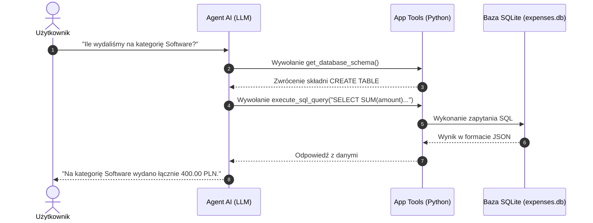

# 🤖 Team Expense AI Agent

Autonomiczny agent AI napisany w Pythonie, służący do analizy i zarządzania wydatkami firmowymi w języku naturalnym przy użyciu bazy danych SQLite oraz wzorca **Tool Calling**.


---

## 🏗️ Architektura Systemu

Agent działa w pętli decyzyjnej (**Agentic Loop**). Na podstawie pytania użytkownika w języku naturalnym samodzielnie decyduje, jakie narzędzie wywołać, odpytuje bazę danych i generuje ustrukturyzowaną odpowiedź biznesową.



---

## 🧰 Stos Technologiczny

| Warstwa | Technologia / Biblioteka |
| :--- | :--- |
| **Język główny** | Python 3.11+ |
| **LLM Provider / API** | Groq API (`openai/gpt-oss-20b`) / OpenAI API (`gpt-4o-mini`) |
| **Baza danych** | SQLite3 |
| **Testy jednostkowe** | Pytest |
| **Konteneryzacja** | Docker, Docker Compose |
| **Zarządzanie środowiskiem** | `python-dotenv`, `pydantic` |

---

## 🚀 Szybkie Uruchomienie

### Opcja A: Uruchomienie przez Docker (Rekomendowane)

1. Sklonuj repozytorium:
   ```bash
   git clone [https://github.com/twoj-username/ai-agent.git](https://github.com/twoj-username/ai-agent.git)
   cd ai-agent
   ```
2. Stwórz plik `.env` na podstawie `.env.example`:
   ```bash
   cp .env.example .env
   ```
   *Wpisz swój `GROQ_API_KEY` lub `OPENAI_API_KEY` w pliku `.env`.*

3. Uruchom kontener:
   ```bash
   docker-compose up --build
   ```

---

### Opcja B: Uruchomienie lokalne (Virtual Environment)

1. Stwórz i aktywuj środowisko wirtualne:
   ```bash
   python -m venv venv
   # Windows:
   venv\Scripts\activate
   # Linux/macOS:
   source venv/bin/activate
   ```
2. Zainstaluj zależności:
   ```bash
   pip install -r requirements.txt
   ```
3. Inicjalizuj bazę danych:
   ```bash
   python -m app.database
   ```
4. Uruchom aplikację:
   ```bash
   python -m app.main
   ```

---

## 🧪 Testowanie

Uruchomienie automatycznych testów jednostkowych:

```bash
python -m pytest
```