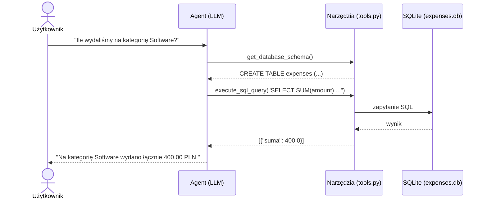

# AI Agent do analizy wydatków

Agent AI w Pythonie, który odpowiada na pytania o wydatki firmowe zadawane zwykłym językiem. Model sam decyduje, jakie zapytanie SQL wykonać na bazie SQLite (wzorzec **tool calling**), a potem podsumowuje wynik po polsku.

## Jak to działa

1. Użytkownik zadaje pytanie w konsoli.
2. Model dostaje pytanie oraz dwa narzędzia:
   - `get_database_schema` - zwraca strukturę tabeli `expenses`,
   - `execute_sql_query` - wykonuje zapytanie SQL i zwraca wynik w JSON.
3. Agent wywołuje narzędzia tyle razy, ile potrzebuje (maksymalnie 5 kroków), i zwraca odpowiedź.



## Technologie

- Python 3.11+
- OpenAI SDK - Groq API (model `openai/gpt-oss-20b`) albo OpenAI API (model `gpt-4o-mini`)
- SQLite
- pytest
- Docker, Docker Compose

## Struktura projektu

```
ai-agent-expense-management/
├── app/
│   ├── agent.py         # pętla agenta i komunikacja z modelem
│   ├── database.py      # tworzenie bazy i przykładowe dane
│   ├── main.py          # interfejs w konsoli
│   └── tools.py         # narzędzia dla modelu i sprawdzanie zapytań SQL
├── tests/
│   └── test_tools.py
├── .env.example
├── Dockerfile
├── docker-compose.yml
├── pytest.ini
└── requirements.txt
```

## Konfiguracja

Skopiuj `.env.example` do `.env` i uzupełnij jeden z kluczy:

| Zmienna | Skąd wziąć |
| :--- | :--- |
| `GROQ_API_KEY` | [console.groq.com/keys](https://console.groq.com/keys) (darmowy) |
| `OPENAI_API_KEY` | [platform.openai.com/api-keys](https://platform.openai.com/api-keys) |

Jeśli podasz oba klucze, używany jest Groq.

## Uruchomienie

### Docker

```bash
git clone https://github.com/Pb-Lead0110/ai-agent-expense-management.git
cd ai-agent-expense-management
cp .env.example .env
docker compose build
docker compose run --rm expense-agent
```

Baza jest tworzona przy budowaniu obrazu. Dane dodane w kontenerze znikają po jego zamknięciu.

### Lokalnie

```bash
python -m venv venv

# Windows:
venv\Scripts\activate
# Linux/macOS:
source venv/bin/activate

pip install -r requirements.txt
python -m app.database
python -m app.main
```

`python -m app.database` tworzy plik `expenses.db` z 6 przykładowymi wydatkami. Ponowne uruchomienie przywraca dane początkowe.

## Przykładowe pytania

- Ile łącznie wydaliśmy na kategorię Software?
- Pokaż 3 najdroższe wydatki.
- Jaki był średni wydatek w październiku?
- Dodaj wydatek: 150 zł na kawiarnię w kategorii Food.
- Zmień kwotę wydatku o id 1 na 175 zł.

Aby zakończyć, wpisz `exit` albo `q`.

## Zabezpieczenia

Zapytania SQL pisze model, więc przed wykonaniem każde jest sprawdzane w `tools.py`:

- dozwolone są tylko zapytania zaczynające się od `SELECT`, `WITH`, `INSERT` i `UPDATE`,
- `UPDATE` musi mieć `WHERE`, żeby nie zmienić wszystkich wierszy naraz,
- blokowane są m.in. `DROP`, `DELETE`, `ALTER`, `CREATE`, `PRAGMA`,
- SQLite nie wykona kilku zapytań naraz (np. `SELECT ...; DROP TABLE ...`).

To proste zabezpieczenie oparte na słowach kluczowych, wystarczające w projekcie demonstracyjnym. W prawdziwej aplikacji agent powinien łączyć się z bazą przez osobnego użytkownika z ograniczonymi uprawnieniami.

## Testy

```bash
pytest
```

Testy działają na tymczasowej bazie, więc nie zmieniają `expenses.db`. Sprawdzają narzędzia bazodanowe i blokowanie niebezpiecznych zapytań. Nie wywołują API modelu, więc nie potrzebują klucza.
